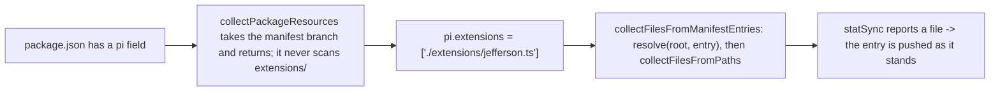

# Design

## Context

This design settles the source layout for `pi-jefferson`. It adds no statusline behavior and moves
no file. The motivation is in `proposal.md`; this section records only the state the approach must
fit and the constraints that force its shape.

**Current state**, read at `4a1bf27` (`release-on-merge`):

- One shipped source file, `extensions/jefferson.ts`, default-exporting a factory that registers
  `/jefferson` and does nothing else.
- One test, `tests/jefferson.test.ts`, importing that file by relative path.
- `package.json` has no `pi` field; `files` is `["extensions", "README.md", "LICENSE"]`;
  `@earendil-works/*` are `peerDependencies` with a `*` range and absent from `dependencies`.
- `tsconfig.json` is `noEmit`, `allowImportingTsExtensions`, with
  `include: ["extensions/**/*.ts", "tests/**/*.ts"]`.
- `.github/workflows/ci.yml` asserts the tarball is exactly
  `["LICENSE", "README.md", "extensions/jefferson.ts", "package.json"]`.

**How the host resolves a manifest**, read from the pinned host,
`node_modules/@earendil-works/pi-coding-agent@1.4.0`, `dist/core/pi-manifest.js` and
`dist/core/package-manager.js`:



Three properties follow, and the design rests on them:

1. A package carrying a `pi` field takes the manifest branch — `readPiManifest` returns a truthy
   object, so `collectPackageResources` returns from the manifest branch and never reaches the
   `collectResourceFiles(join(packageRoot, "extensions"))` scan. A stray file at `extensions/` level
   is not loaded.
2. A plain manifest entry is resolved with `resolve(root, entry)` and pushed by
   `collectFilesFromPaths` when `statSync` reports a file; nothing resolves it further. The file the
   manifest names is the entry, as it stands.
3. Nothing enumerates the working-parts directory. The manifest branch names one file and returns,
   so no code path reads `extensions/jefferson/`'s contents; a module added there cannot join the
   entry set.

A second place the manifest is honoured is the project-local discovery path: for a configured path,
`resolveExtensionEntries` (loader.js) reads that directory's `package.json` `pi` field and returns
the declared paths. That is the path `tasks.md` 4.1's discovery command exercises; the auto-scan
bypass of property 1 is `collectPackageResources`, which that command does not call.

**Constraint that shapes everything:** there is no build step and there will not be one. These
`.ts` files are the shipped artifact — transpiled in-process by the host's jiti and executed
directly by `npm test` under Node's type stripping — so only erasable TypeScript is permitted.

**Record correction.** `proposal.md`'s option comparison says option B "changes nothing the
host, `tsconfig`, or CI asserts." That is false as written, and the council established it: the
current CI assertion pins `extensions/jefferson.ts` by name, and option B as proposed moved that
file. The settled shape moves nothing, so that particular drift cannot happen — but the CI step
still changes, for the different reason D3 gives. This design does not edit `proposal.md`; the
correction is recorded here. What the chosen shape leaves unchanged is narrower, and is stated
under D6.

## Goals / Non-Goals

**Goals:**

- One stated place the host loads from, declared in the repository rather than inferred from a
  convention a reader must already know, with the load contract readable by a human.
- A directory the extension grows into without editing `package.json`, `tsconfig.json`, or CI.
- A CI check that still catches a `files` mistake, and no longer fails when an ordinary module
  is added.
- Show, requirement by requirement, that the chosen shape satisfies
  `specs/extension-source-layout/spec.md`.

**Non-Goals:**

- The statusline: its modules, format strings, rows, alignment, truncation.
- A second extension in this package. A second extension is a new package.
- Moving a file. The entry stays at `extensions/jefferson.ts`, so the test's import path is
  untouched.
- Any change to `/jefferson`'s behavior, the release workflow, the version contract, or the
  dependency set.
- A build step, lint, or formatting tooling.

## Decisions

### D1. The layout is `extensions/jefferson.ts` beside `extensions/jefferson/`, declared by the manifest

```text
pi-jefferson/
├── extensions/
│   ├── jefferson.ts        <- the entry: the only file the host loads
│   └── jefferson/          <- the extension's working parts; the host never enumerates them
│       └── <modules>.ts
├── tests/jefferson.test.ts
└── package.json            "pi": { "extensions": ["./extensions/jefferson.ts"] }
```

`package.json` gains exactly one field:

```json
"pi": { "extensions": ["./extensions/jefferson.ts"] }
```

Rationale. The manifest names the exact file the host loads, and the directory beside it holds the
working parts. `extensions/` is pi's resource-type directory, so a file in it is named for the
extension it provides rather than for its position: `extensions/jefferson.ts` and
`extensions/jefferson/` then read together as "the jefferson extension, and its working parts." The
owner was offered `extensions/index.ts` and kept `jefferson.ts`.

The manifest value names the **file**, not a directory. Because the package now has a `pi` field,
the host takes the manifest branch (Context, property 1), so the `extensions/` directory is never
scanned — the stray-file cost a plain convention layout carries is gone — and the working-parts
directory is never enumerated (property 3). The entry is pushed as it stands (property 2): no
`index.ts` resolution stands between the declaration and the loaded file.

**The one convention this shape needs.** An import from the entry must name a file inside the
working-parts directory: `import { ROWS } from "./jefferson/rows.ts"`. A bare `./jefferson` cannot
be used, because the working-parts directory shares its stem with the entry file beside it and
`moduleResolution: nodenext` rejects the extensionless specifier (measured: `extensions/jefferson.ts`
importing `"./jefferson"` fails `npm run typecheck` with `TS2835: Relative import paths need
explicit file extensions in ECMAScript imports when '--moduleResolution' is 'node16' or 'nodenext'.
Did you mean './jefferson.js'?`, while `"./jefferson/rows.ts"` typechecks). The compiler enforces
the convention, so nothing here needs a lint.

Alternatives considered and rejected, against this shape:

- **Declare the working-parts directory**, `["./extensions/jefferson"]`, with the entry at
  `extensions/jefferson/index.ts` — the shape D1 carried before the owner's correction. It resolves,
  through the host's directory branch (`resolveExtensionEntries` returns the directory's `index.ts`),
  but it hides which file loads behind `index.ts`, a name that states no responsibility, and it
  costs a file move plus a test-import edit. Not taken.
- **Declare `["./extensions"]`.** It resolves to the `extensions/` directory, re-enters
  `collectAutoExtensionEntries` on it, and scans its contents — a stray `.ts` at that level, or a
  sibling directory with an `index.ts`, would become a second extension. Not taken.
- **No manifest; rely on the `extensions/<name>.ts` convention.** Works — the fallback auto-scan
  finds `extensions/jefferson.ts` as a direct file — but leaves the load root implicit, which the
  ruling rejected, and leaves `extensions/` a live auto-discovery root. Not taken.
- **Manifest-declared `src/`** (option C). Its one advantage over this shape, that no directory is
  auto-scanned, is delivered here by the `pi` field bypassing discovery entirely; C additionally
  required `files` and `tsconfig.json` `include` to move. Not taken.

### D2. The load contract's human home is the entry file's header

The manifest states the contract to pi. The entry's filename states which extension the file
provides, not which file loads, so the contract is stated to a person in a doc comment at the top of
the file the manifest names — the first file a contributor following the manifest opens. The header
reads:

```ts
/**
 * pi-jefferson — a starship-style statusline for pi.
 *
 * `package.json` declares this file to pi:
 *   "pi": { "extensions": ["./extensions/jefferson.ts"] }
 * pi loads `jefferson.ts` — this file — as the extension. Every file in the
 * `extensions/jefferson/` directory beside it is the extension's working parts,
 * imported by relative path; the host never loads them.
 * ...
 */
```

Rationale. The sentence must travel with the code, and it must sit where the code it describes sits.
The repository already sets this precedent: `tests/jefferson.test.ts`'s header states the
tests-are-never-beside-extensions rule next to the file it governs. A README sentence would describe
a contributor fact in a file whose job is install instructions for consumers.

**The header needs no apology for the entry filename.** `extensions/jefferson.ts` names which file
loads and `extensions/jefferson/` names what does not, so the inference the paths owe the reader is
delivered by the paths themselves — the entry filename pairs with the directory it owns, and every
file in that directory is a working part without exception, because the entry is no longer inside
it. The earlier directory declaration had to
carry this meaning in prose because `index.ts` named nothing; here the header states the contract
and the paths state the responsibilities. This is the framing the header was written toward: the
manifest says to pi *"here's the extension directory you expect"*, and the header says to a person
*"jefferson is the extension's working parts"* — the second sentence lives with the code it
describes.

### D3. The CI check becomes path invariants plus a manifest pin

The existing exact-list assertion is not stale by a move — there is no move — but it is still wrong
for this package: it fails on every ordinary module added under `extensions/jefferson/`,
contradicting the spec's requirement that an ordinary module require no new CI expectation. Replace
the step with this, which pins the roots, the entry, the absence of tests, and the manifest value,
and permits any number of modules:

```yaml
      # Catches a `files` mistake before it reaches a publish, where it is permanent, and pins
      # the load contract the manifest declares. Ordinary modules under extensions/jefferson/
      # are allowed; only the roots, the entry, and the manifest itself are pinned.
      - name: The tarball and the load contract are what we expect
        run: |
          npm pack --dry-run --json | node -e '
            const fs = require("node:fs");
            const [tarball] = JSON.parse(fs.readFileSync(0, "utf8"));
            const shipped = tarball.files.map((f) => f.path).sort();
            console.log("shipping:", shipped.join(", "));

            const allowed = (p) =>
              p === "package.json" ||
              p === "README.md" ||
              p === "LICENSE" ||
              p.startsWith("extensions/");

            const entry = "extensions/jefferson.ts";
            const loadRoot = ["./extensions/jefferson.ts"];
            const declared = JSON.parse(fs.readFileSync("package.json", "utf8")).pi?.extensions;

            const problems = [];
            const stray = shipped.filter((p) => !allowed(p));
            if (stray.length) problems.push(`paths outside the expected roots: ${stray.join(", ")}`);
            if (!shipped.includes(entry)) problems.push(`the declared entry is not shipped: ${entry}`);
            const tests = shipped.filter((p) => p.endsWith(".test.ts"));
            if (tests.length) problems.push(`test files shipped: ${tests.join(", ")}`);
            if (JSON.stringify(declared) !== JSON.stringify(loadRoot))
              problems.push(`pi.extensions is not exactly ${JSON.stringify(loadRoot)}: ${JSON.stringify(declared)}`);

            if (problems.length) {
              console.error("tarball or load contract changed; " + problems.join("; "));
              process.exit(1);
            }
          '
```

What it refuses, and what makes it fire:

| Refusal | Input that fires it |
|---|---|
| A path outside the allowed roots | a stray file added to `files`, e.g. `notes.md`, or `tests/` re-added |
| The declared entry is not shipped | `extensions` dropped from `files` |
| A test file shipped | any `*.test.ts` reachable through `files` |
| The load root is not the single declared file | `pi.extensions` set to `[]`, to two entries, or to `["./extensions"]` |

The ordinary case passes by construction: `extensions/jefferson/rows.ts` starts with `extensions/`
and is not a `*.test.ts`, so adding modules is invisible to the check. The manifest pin also gives
the declared load root the machine check a manifest otherwise lacks — the gap the council noted as
option C's cost.

**The guard has been shown red.** The decision logic above was run against synthetic tarball sets
and manifest values; the run printed:

```text
pass  current-good (file entry)
pass  ordinary module added
FAIL  stray root file in files  [paths outside the expected roots: notes.md]
FAIL  entry dropped from files  [the declared entry is not shipped: extensions/jefferson.ts]
FAIL  tests added to files  [paths outside the expected roots: tests/jefferson.test.ts; test files shipped: tests/jefferson.test.ts]
FAIL  manifest: zero entries  [pi.extensions is not exactly ["./extensions/jefferson.ts"]: undefined]
FAIL  manifest: two entries  [pi.extensions is not exactly ["./extensions/jefferson.ts"]: ["./extensions/jefferson.ts","./extensions/other.ts"]]
FAIL  manifest: wrong path  [pi.extensions is not exactly ["./extensions/jefferson.ts"]: ["./extensions"]]
```

The same guard was also run against real `npm pack --dry-run --json` output in a scratch copy of the
repository carrying only this change's manifest field: it printed
`shipping: LICENSE, README.md, extensions/jefferson.ts, package.json` and exited 0, and it stayed
green with a real ordinary module present, printing
`shipping: LICENSE, README.md, extensions/jefferson.ts, extensions/jefferson/rows.ts, package.json`.
The implementation must repeat both on the real tree, where the rewritten header is also present.

### D4. The working-parts directory states its membership and its dependency rule

Per the spec's requirement on grouping directories, `extensions/jefferson/` states both:

- **Membership.** Every file in the directory is a working part of the one `jefferson` extension.
  The entry is not in it — it is `extensions/jefferson.ts`, beside the directory.
- **Dependency rule.** `extensions/jefferson.ts` is the entry and the only module that may contain a
  runtime import of a host package (`@earendil-works/*`). Internal modules import each other by
  relative path and, when they need a host type, use `import type`. Module filenames name the
  behavior or data they own; `utils`, `helpers`, `misc`, and `common` do not exist.

This is the directory's local form of the spec's host-import boundary: today the boundary holds
because the entry carries only `import type { ExtensionAPI }`, and this rule keeps it holding as
modules are added.

### D5. One package, one extension

The package ships exactly one extension. `package.json`'s manifest array carries exactly one
entry, and a second extension is a new package rather than a second file or directory here — the
owner's ruling that multiple extensions in one package break single responsibility. The CI manifest
pin (D3) enforces "exactly one": a second array entry turns CI red.

### D6. What this change touches, and what it leaves alone

Changed in the implementation phase:

| File | Change |
|---|---|
| `extensions/jefferson.ts` | the header comment becomes the D2 text; the code below it does not change |
| `package.json` | the `pi` field of D1 is added |
| `.github/workflows/ci.yml` | the tarball step is replaced by D3 |

Unchanged, deliberately:

- `tests/jefferson.test.ts` — no file moves, so its import `../extensions/jefferson.ts` stays as it
  is.
- `package.json` `files` — `["extensions", …]` already ships the whole `extensions/` subtree, the
  entry and every module under `extensions/jefferson/` alike.
- `tsconfig.json` `include` — `extensions/**/*.ts` already matches the entry and the working-parts
  directory, so every shipped file stays typechecked.
- `peerDependencies` — the host packages stay `*`-ranged peer dependencies, absent from
  `dependencies`.
- `/jefferson`'s behavior, the release workflow, and the version contract.

`files` and `include` not moving is the narrow, true version of the claim `proposal.md` made too
broadly; see the record correction under Context.

### Spec alignment

`specs/extension-source-layout/spec.md` is the contract. One row per `### Requirement:` heading
in that file:

| Requirement | How this shape satisfies it |
|---|---|
| One host-loaded entry per extension | The manifest names one file; the host pushes exactly that file and reaches nothing else (Context, properties 2 and 3), so working parts are not discoverable and adding one does not change the entry set. Measured: discovery reports `count: 1` and `commands: [ 'jefferson' ]` with a stray `extensions/notes.ts` and `extensions/other/index.ts` present. |
| The load root is singular and stated | `pi.extensions: ["./extensions/jefferson.ts"]` is the one mechanism; the `pi` field makes discovery take the manifest branch, so no second source directory is reachable (property 1). The CI pin asserts the value. |
| Tests never occupy a loadable or shipped path | Tests stay in `tests/`; `tests/` is outside the allowed roots of the CI check and is not in `files`. The check refuses any shipped `*.test.ts`. |
| Host packages are imported only at the load boundary | `peerDependencies` unchanged; the entry holds only a type-only host import and is the only module permitted a runtime host import (D4). |
| Every shipped source file is typechecked and erasable | `extensions/**/*.ts` already covers the entry and the working-parts directory (D6); no build step; erasable-only syntax remains the rule for every module. |
| The published file set is deliberate | `files` ships the `extensions/` subtree; the CI check asserts the allowed roots, the entry, and the absence of tests, so the set is pinned by invariant rather than by a list that goes stale. |
| Responsibility is inferable from path | The entry filename names the extension it provides and pairs with the directory that holds its working parts; modules in that directory name a behavior. This is served better than under the superseded directory declaration, where the loaded file was an `index.ts` that named no responsibility and the header had to say so. |
| Growth is a named change | An ordinary module under `extensions/jefferson/` needs no edit to `package.json`, `tsconfig.json`, or CI (D3's ordinary case, D6). A new source root, a second entry, or a manifest change is a named change that updates the pinned mechanisms. |

All eight hold under this shape.

**Requirement 6 is amended by this change, not satisfied as originally drafted.** Its first
version required CI to assert the tarball's *exact enumerated set*. That cannot hold alongside
requirement 8, which forbids a CI edit for an ordinary module: an enumerated assertion changes
every time a module is added. The design gate found the contradiction, and the owner's amendment —
"the CI check moves off a static file list" — mandates the resolution. `spec.md` now carries the
invariant wording, and this change amends it in place.

An earlier draft of this table claimed "no requirement is weakened to fit the shape." That was
wrong, and the gate was right to refuse it. One requirement was **changed**, deliberately, on the
record, and because the owner's ruling required it.

## Risks / Trade-offs

- **A wrong manifest path fails silently.** `collectFilesFromPaths` skips a path that does not
  exist, so a typo in `pi.extensions` loads nothing and `/jefferson` disappears with no startup
  diagnostic. Measured on the pinned host: with `["./extensions/lefferson.ts"]` the discovery
  command prints `count: 0` and `errors: []`, exit 0.
  → Mitigation: the CI check asserts the manifest equals `["./extensions/jefferson.ts"]` *and* that
  `extensions/jefferson.ts` is shipped, so a typo and a manifest/entry disagreement both fail before
  merge.
- **A published tarball is permanent.** The layout changes what loads; a bad version cannot be
  meaningfully unpublished. → Mitigation: CI and `release.yml` both run typecheck and tests, and
  the entry's resolution is a pinned invariant, not a convention the release path could drift
  from.
- **Tooling that hardcodes `extensions/` when inspecting a package** would miss a manifest entry
  (recorded unverified in `council.md`). → Mitigation: the source still lives under `extensions/`,
  and the entry is a direct file there, so convention-based inspection finds it; only the load is
  declared.
- **The entry and the working-parts directory share a stem.** `extensions/jefferson.ts` and
  `extensions/jefferson/` sit side by side, so a reader can mistake one for the other's index, and
  the entry cannot import the directory by its bare name (D1). → Trade-off accepted by the settled
  shape; the compiler refuses the bare specifier, and the D2 header states which path is which.
- **A malformed-but-object `pi` field disables the extension silently, and this is the sharper
  half of the silent-failure risk.** `readPiManifest` returns `null` only when `pkg.pi` is *not an
  object*, and only then does the host fall back to auto-discovery, which would still resolve
  `extensions/jefferson.ts`. If `pi` *is* an object carrying a malformed `extensions` value —
  a string, or an array holding a non-string — `readPiManifest` returns `{}`, which is truthy:
  `collectPackageResources` takes the manifest branch, `addManifestEntries` receives `undefined`
  for extensions and returns, and **nothing loads, with no fallback and no diagnostic.** An earlier
  draft of this design claimed the degradation was benign; it is not, and the host source above is
  what disproves it.
  → Mitigation: the CI check asserts the manifest equals `["./extensions/jefferson.ts"]` exactly, so
  a malformed value cannot merge. This is why the manifest pin is load-bearing rather than
  decorative.

## Migration Plan

Ordered for the implementation phase:

1. Replace the header comment at the top of `extensions/jefferson.ts` with the D2 text; the code
   below it does not change.
2. Add the `pi` field to `package.json`.
3. Replace the `ci.yml` tarball step with D3's code.
4. Run `npm run typecheck`, `npm test`, and `npm pack --dry-run`; confirm the tarball is
   `LICENSE, README.md, extensions/jefferson.ts, package.json` and the guard exits 0.
5. Run the discovery check in `tasks.md` 4.1 against the real tree and confirm the host loads the
   entry.

Rollback: before merge the change is one branch and is discarded whole. After merge it releases
(a patch), and that tarball is permanent, so the gate is a green PR — the CI check above is the
gate. Reverting a published version is a new version, not an unpublish.

## Open Questions

- Whether third-party pi tooling hardcodes `extensions/` when inspecting installed packages
  (recorded unverified in `council.md`). It does not change this design: the source stays under
  `extensions/`, and the entry is a direct file there.
- Whether to add a CI step that installs the packed tarball into a real `pi` and verifies
  `/jefferson` loads. Deferrable; no spec requirement asks for it, and the entry resolution is
  pinned without it.

## Clarification note — 2026-11-01: the manifest names the file, not the directory

**This is the record of why the reading changed, kept for the trail.** The body above now states the
settled shape (D1, D2, D6). Four artifacts other than the design still carry the earlier directory
declaration, and they are named in **Superseded artifacts** below; read that before believing any of
them.

**This is not a reversal of the owner's intent. It is D1 being rewritten to match it.** The design
read *"here's the extension directory you expect"* as a declaration of the **directory**, so D1 moved
the entry to `extensions/jefferson/index.ts` and pointed the manifest at the directory. The owner
corrected that reading: the manifest names the **file**, and the sentence was about saying plainly
which file loads and which directory holds the working parts. His words, on being told this was
framed as a change of shape: *"I don't know that this is a different shape. it's what i was trying to
convey when I explained things. I just dont think I did it well."*

**Why the settled shape is better on three counts.**

1. **Explicitness increases.** The manifest names the exact file that loads rather than a directory
   the host then resolves an `index.ts` out of — which was the one place D2 had to apologise for
   `index.ts` naming no responsibility.
2. **The working-parts directory gets one rule with no exception.** Under the directory declaration,
   `extensions/jefferson/` contained the entry *and* the working parts, so its membership rule
   carried an exception for `index.ts`. Here everything in the directory is a working part.
3. **No file moves.** `extensions/jefferson.ts` stays where it is, so `tests/jefferson.test.ts`'s
   import path does not change and the diff loses the rename entirely.

**What it costs.** One convention, stated in D1: an import from the entry must name a file inside the
directory (`./jefferson/rows.ts`), because the working-parts directory shares its stem with the entry
file beside it. `files` and `tsconfig.json` `include` are unchanged; the CI guard's shape is
unchanged, and its pinned entry value is `extensions/jefferson.ts` — the path the existing exact-list
assertion already pins.

**Superseded artifacts.** Four artifacts other than the design carry the directory declaration, and
none is relied on here. Two are verdicts returned for a shape that no longer stands: the design
gate's round-2 verdict (`design-gate-r2.md`) and the plan gate's round-3 verdict
(`plan-gate-r3.md`). Two state the directory as **agreed or adopted**, which is now wrong:
`council.md`'s "Ruling amended — 2026-11-01, by the owner" ("The agreed shape is B's directory with
the load explicitly declared", `"pi": { "extensions": ["./extensions/jefferson"] }`), and
`proposal.md`'s "Superseded, 2026-11-01" block ("The option as finally adopted is the amended
ruling, which is B's directory shape"). The proposal block was the round-1 fix for a different
error — the CI falsehood — and did not survive this shape change intact, so it names the wrong
adopted shape. The amended ruling in `council.md` is the owner's own ruling of that date; what has
changed is which declaration it resolves to, and the owner's statement is the one recorded above.

**Gates.** D1, D2's header target, and D6 all change from the drafts the gates read, so the design
gate re-runs against this revision and the plan's steps follow it. Nothing is implemented, so this is
the cheapest moment the change could be made.
